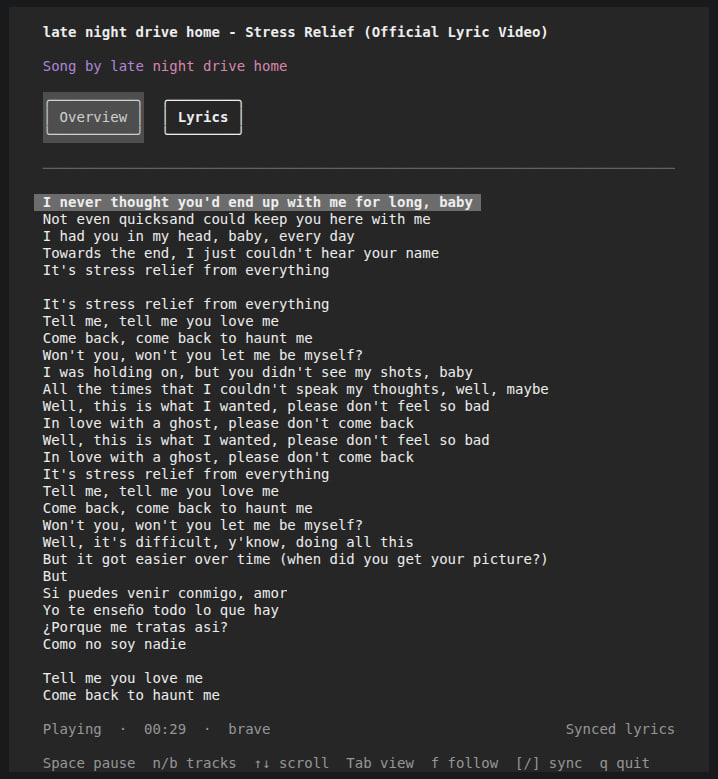

# Terminal Lyrics (terlg)

A lightweight Linux terminal app for controlling an MPRIS music player and
showing synchronized lyrics from [LRCLIB](https://lrclib.net/). Built with
C++17, POSIX APIs, and small shell scripts; no UI framework is required.



## Features

- Play/pause and next/previous-track controls through `playerctl`.
- Overview and Lyrics views with automatic synchronized-lyric highlighting.
- Manual scrolling, automatic follow mode, and adjustable lyric timing.
- Plain-text fallback when synchronized timing is unavailable or unsuitable.
- Background lyrics loading with cancellation on rapid track changes.
- An in-memory LRU cache for up to 64 successfully loaded tracks per session.
- Bounded network/process waits and bounded API-response sizes.
- Responsive terminal resizing and terminal restoration on normal exit or
  termination signals.

## Dependencies

- Linux and a terminal with ANSI escape-sequence support.
- A C++17 compiler and `make` (`build-essential` on Debian/Ubuntu).
- [`playerctl`](https://github.com/altdesktop/playerctl) and a running MPRIS
  player on the same D-Bus session.
- `curl` and internet access for lyrics that are not already cached.
- `git` only if you clone the repository with Git.

Install the build and runtime dependencies on Debian or Ubuntu:

```bash
sudo apt install git build-essential curl playerctl
```

Spotify, VLC, Firefox, Brave, and other players with MPRIS support can be used
through `playerctl`. A player without MPRIS support cannot be controlled or
read by terlg.

## Install and run

```bash
git clone https://github.com/Sopanhaa/terlg.git
cd terlg
./run.sh
```

`run.sh` builds the app automatically and starts it in the current terminal.
Start a song in your media player before or after launching terlg.

To select a specific player, list its exact MPRIS name first:

```bash
playerctl --list-all
./run.sh --player brave
```

You can also build and launch manually:

```bash
./build.sh
./build/terminal-lyrics
```

## Command-line options

```text
Usage: terminal-lyrics [--player NAME] [--refresh SECONDS] [--offset SECONDS]
```

| Option | Meaning |
| --- | --- |
| `--player NAME` | Use the exact player name reported by `playerctl --list-all`. |
| `--refresh SECONDS` | Playback polling interval; default `0.5`, minimum `0.1`. |
| `--offset SECONDS` | Initial lyric offset; positive values advance lyrics. |
| `-h`, `--help` | Show command-line help. |

Both `--player NAME` and `--player=NAME` forms are accepted for options with
values. Settings and timing adjustments apply only to the current session.

## Keyboard controls

| Key | Action |
| --- | --- |
| Space | Play or pause. |
| `n` / `b` | Next / previous track. |
| Tab, Shift+Tab, Left / Right | Switch between Overview and Lyrics. |
| `1` / `2` | Open Overview / Lyrics directly. |
| Up / Down | Scroll one row and pause automatic following. |
| Page Up / Page Down | Scroll five rows. |
| Home / End | Go to the first / last scroll position. |
| `f` | Resume automatic lyric following. |
| `[` or `-` | Delay lyrics by 0.25 seconds. |
| `]` or `+` | Advance lyrics by 0.25 seconds. |
| `0` | Reset the lyric timing offset. |
| `q` or Ctrl+C | Quit and restore the terminal. |

Synchronized lyrics highlight and follow the current line automatically.
Manual scrolling temporarily stops following; press `f` to resume. Plain
lyrics require manual scrolling. To avoid visibly incorrect timing, terlg can
fall back to plain lyrics when a result has a known, incompatible recording
duration.

Lyrics lookup sends the track title, artist, and sometimes album to LRCLIB.
The cache is in memory only and is cleared when the app exits.

## Build and test

Build without starting the app:

```bash
./build.sh
```

Run the complete automated suite:

```bash
./test.sh
```

The tests do not require internet access or a real music player. They use
mock lyrics responses, mock `playerctl`/`curl` executables, and a
pseudo-terminal to cover metadata parsing, playback-clock behavior, loader
cancellation/cache behavior, subprocess limits, malformed/offline API
responses, keyboard controls, resizing, no-player handling, and terminal
restoration. Tests do not replace manual verification with your own player.

Use `make clean` to remove generated build files.

## Troubleshooting

### `playerctl` or `curl` is missing

Install the dependencies listed above, then open a new terminal and try again.
Check that both commands are available:

```bash
playerctl --version
curl --version
```

### No active music player is found

1. Confirm that the player is running and exposes Linux media controls.
2. Run `playerctl --list-all` in the same desktop/D-Bus session as terlg.
3. If more than one player is listed, pass the exact name with `--player`.
4. Check `playerctl metadata` independently; if that fails, terlg cannot read
   the player either.

### Lyrics are missing or cannot be loaded

Check your internet connection and whether LRCLIB is reachable. LRCLIB may not
have every recording, may temporarily rate-limit requests, or may return only
plain lyrics. Try the original album/version of the track if a video upload or
cover has misleading metadata.

### Lyrics are too early or too late

Use `[` to delay or `]` to advance the display in 0.25-second steps. Press `0`
to reset. A known recording-duration mismatch is shown as plain lyrics rather
than potentially misleading synchronization.

### The layout looks wrong

Enlarge the terminal to at least 30 columns by 8 rows. terlg redraws after a
resize. Set `NO_COLOR=1` before launch to disable color. Normal exits restore
the cursor, alternate screen, and input settings; if the process is forcibly
killed and cannot clean up, run `reset` in that terminal.
